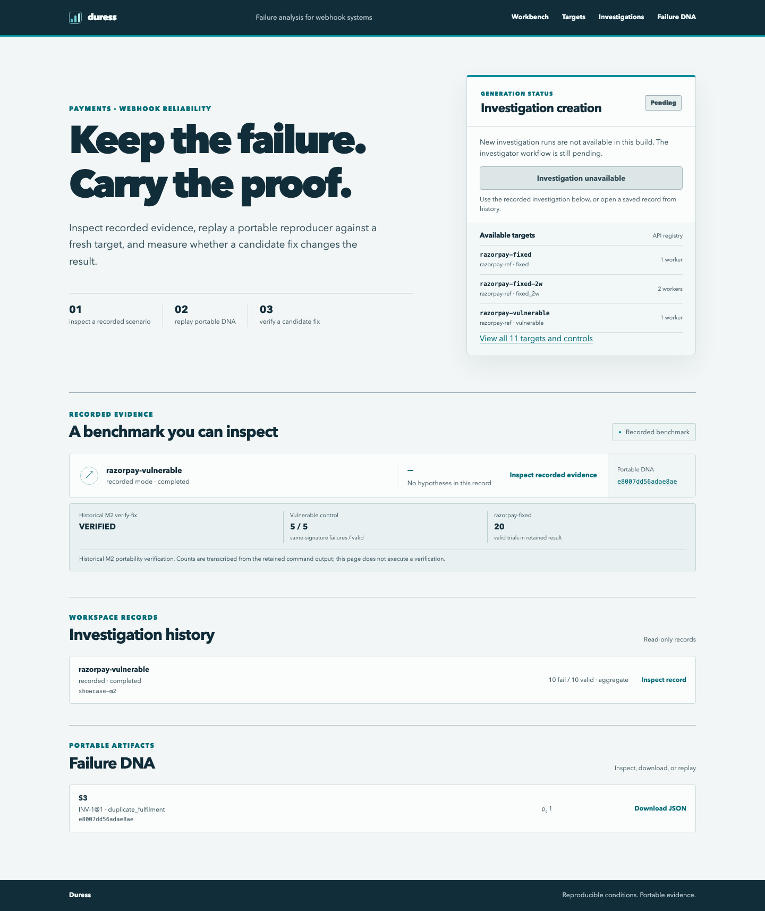

# Duress

**Put your integrations under pressure. Keep the proof.**

Duress is a reliability workbench for developers maintaining event-driven integrations. It runs controlled deliveries against this repository’s synthetic payment-webhook targets, checks persisted business effects, and keeps a portable reproducer when an invariant breaks.

A successful HTTP response is an observation. The committed payment, order and fulfilment state determines the verdict.



[Recorded evidence](docs/screenshots/recorded-evidence.png) · [Failure DNA view](docs/screenshots/failure-dna.png)

## What works today

- A server-rendered **Jinja + HTMX web application**: workbench, target profiles, investigation records, Failure DNA library and detail, and saved replay and verification results.
- An explicitly labelled **recorded M2 showcase**, with the original artifact, delivery sequence, release conditions, invariant violation, and historical vulnerable/fixed comparison. Browsing it starts no experiment.
- **Portable DNA download and import/replay**, preflight integrity checks, and real fix verification through the existing API and deterministic services.
- A CLI for scenario execution, DNA creation, replay, fix verification, cleanup, and standalone HTML reports.
- The M0–M2 execution foundation: isolated target processes, the closed scenario registry, complete invariant packs, and deterministic verdict aggregation.

**Pending:** autonomous source-grounded investigation, live/cached model support, failure reduction and `naive_fix`. The interface labels investigation creation and reduction as unavailable. It does not manufacture model findings or live results. The current release adds the product experience around M0–M2; it does not claim completion of M3–M6 in the [frozen plan](plan.md).

## Quickstart

Requires Python 3.12+, [uv](https://docs.astral.sh/uv/), and macOS or Linux. Work from the repository checkout; bundled target profiles are part of the application.

```bash
git clone https://github.com/marsh15/Duress.git
cd Duress
uv sync --frozen
uv run duress serve --port 8000
```

Open **http://127.0.0.1:8000**. Inspect the recorded benchmark, open its Failure DNA, download it, then use **Replay** or **Verify fix** to execute the existing local services. Results appear inline and have a saved result page. No external provider or model credentials are needed.

To replay a file, open the **Failure DNA** library and choose **Import portable JSON**. An import is checked before execution and is not silently added to the workspace. Target selectors accept only registered local implementations.

## CLI

```bash
uv run duress targets
uv run duress run razorpay-fixed --scenario S3 --copies 3 --fault rendezvous
uv run duress dna build razorpay-vulnerable --scenario S3 --copies 2
uv run duress dna list
uv run duress replay <dna_id>
uv run duress verify-fix <dna_id> --candidate razorpay-fixed
uv run duress report showcase --output /tmp/duress-report.html
uv run duress sweep
```

`run`, `replay` and `verify-fix` support `--json`. Exit codes: `0` PASS / NOT_REPRODUCED / VERIFIED; `1` FAIL / REPRODUCED / DIFFERENT_FAILURE / NOT_VERIFIED; `2` INCONCLUSIVE; `3` usage error; `4` REJECTED. A reproduced defect deliberately returns a nonzero exit code.

`report` exports an existing record without executing it. The bundled showcase is a read-only record assembled from retained M2 evidence, not an autonomous investigation.

## How it works

The web application and CLI call the same service layer. Every trial gets a fresh database, ephemeral port, signing secret, provider namespace, instance identity and process group. Managed targets bind only to `127.0.0.1`. The supervisor confirms process-group termination by **process-table inspection** before copying SQLite state for the oracle; signal return codes are not proof of termination.

Failure DNA embeds the execution semantics, complete invariant pack, expectation, fixtures, roles and schedule. Preflight hashes the **loaded reproducer mapping** before execution. Replay regenerates signatures. Verification re-establishes the control failure before sizing and running the candidate trials.

Read the [architecture](docs/ARCHITECTURE.md), [artifact contract](docs/FAILURE_DNA.md), [engineering decisions](docs/DECISIONS.md), and [executed evidence](docs/EVIDENCE.md). Detailed history is in the [implementation log](docs/IMPLEMENTATION_LOG.md).

## Verification

```bash
uv run pytest -q -m 'not slow and not browser'
uv run playwright install chromium
DURESS_BROWSER_TESTS=1 uv run pytest -q tests/browser
scripts/smoke.sh http://127.0.0.1:8000
scripts/smoke.sh http://127.0.0.1:8000 --dna showcase/dna/e8007dd56adae8ae.json
```

Browser coverage includes navigation, mobile layouts, keyboard access, axe checks, artifact export, tamper rejection, and real replay/fix verification. Exact commands, counts and limitations belong in [EVIDENCE.md](docs/EVIDENCE.md).

Record new measurements explicitly; ordinary test runs do not rewrite committed measurements:

```bash
DURESS_RECORD_MEASUREMENTS=1 uv run python scripts/measure.py --run fast
uv run python scripts/measure.py --render > /tmp/duress-evidence.md
```

## Docker and deployment

```bash
docker build -t duress:web .
docker run --rm -p 8000:8000 -e PORT=8000 duress:web
```

The public application serves on `0.0.0.0:$PORT`; managed reference targets remain loopback-only. [render.yaml](render.yaml) describes a Render Docker service. **Hosted deployment is not verified.** See the [operations guide](docs/OPERATIONS.md) for local and container smoke checks.

| Variable | Purpose |
|---|---|
| `DURESS_ROOT` | Checkout root containing target profiles; set to `/app` in Docker |
| `DURESS_HOME` | Runtime JSON, evidence and pidfiles; defaults to `.duress/` |
| `DURESS_DEMO_TOKEN` | When set, replay and verification require `X-Duress-Token` or bearer authorization |
| `DURESS_HOSTED` | Marks the hosted deployment in health metadata |
| `PORT` | Container public listening port; defaults to `8000` |

The browser keeps an entered access token in memory only. Hosted runtime data is **ephemeral** and disappears on restart; download DNA you want to retain. The committed showcase is bundled into the image. The existing API allows one operation at a time and applies request quotas.

## Boundaries

The reference defect is a seeded benchmark, not a discovery about a third-party integration. Experiments are restricted to bundled, locally controlled targets. PASS and VERIFIED are bounded empirical statements, not proofs of correctness. DNA digests detect alteration, not authorship. This is a single-workspace developer application, not a multi-user service; records and results are publicly readable when you expose the server. Do not store sensitive production data in the public demo.
