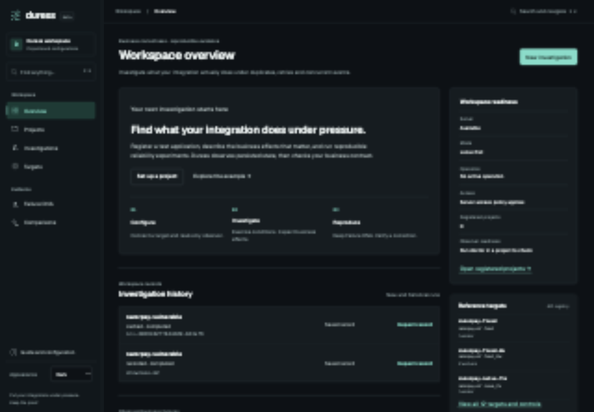

# Duress

**Put your integrations under pressure. Keep the proof.**

Duress is a local-first reliability-testing tool for developer-owned webhook integrations. It runs bounded delivery experiments, independently observes persisted business state through SQLite or PostgreSQL, evaluates configurable business invariants, and preserves failures as portable **Failure DNA**. The original controlled payment benchmark remains available as a guided demonstration.

An HTTP acknowledgment can hide duplicate tickets, missing business effects, and incorrect state transitions. Duress checks declared business entities after managed processes have drained and their termination has been confirmed.



[Light theme](docs/design/screenshots/overview-light.png) · [Executed investigation](docs/design/screenshots/investigation-completed.png) · [Failure DNA](docs/design/screenshots/failure-dna.png) · [Delivery sequence](docs/design/screenshots/delivery-sequence.png) · [Mobile setup](docs/design/screenshots/mobile-setup.png) · [Silent walkthrough](docs/design/screenshots/walkthrough.mp4) · [Design and validation](docs/design/redesign.md)

The workspace includes dark, light and system appearance, keyboard navigation with **Cmd/Ctrl+K**, a local project setup guide at `/guide`, and a shared component reference at `/design-system`. Execution lifecycle and business verdict remain separate. Historical release screenshots and measurements remain in `docs/screenshots` and `docs/release`.

## Use your own application

Build an installable beta wheel with `uv build --wheel`, then install it into Python 3.12. Use the `[postgresql]` extra for PostgreSQL observation. A package-index release has not been published.

```bash
duress init ./owned-integration --project owned-integration
cd owned-integration
duress doctor --config duress.toml --json
duress check --config duress.toml --output result.json --junit result.xml --artifacts artifacts/
duress register --config duress.toml
```

The starter is independently runnable. Replace its manifest, event fixtures and contract with your application's declarations; no engine changes are needed. Use `duress serve` and open `/projects` for approved local-project investigation, evidence, replay, verification and reduction.

[External-project guide](docs/productization/EXTERNAL_PROJECTS.md) · [Invariant contract](docs/productization/CONTRACT.md) · [Independent PostgreSQL ticketing example](examples/ticketing/README.md) · [Reusable CI](docs/productization/CI.md) · [Productization evidence](docs/productization/EVIDENCE.md)

External commands/URLs are disabled in hosted mode. Managed local targets provide verified process settlement; authorized staging delivery currently remains INCONCLUSIVE because remote quiescence is unverified. External investigations use deterministic registered scenarios. Live and cached AI selection remains scoped to the bundled payment pack.

## From investigation to proof

1. **Investigate:** choose a registered target and cached, exhaustive, or configured live mode. Follow persisted execution progress, validated source citations, hypotheses, and actual findings.
2. **Inspect:** see parameterized scenarios, delivery ordering, concurrency groups, injected faults, trial validity, invariant violations, and retained SQLite state.
3. **Carry:** download an integrity-checked Failure DNA artifact containing the schedule, fixtures, expectations, invariant pack, and versioned execution semantics.
4. **Replay and verify:** reproduce the failure in fresh isolated processes, then compare a candidate against the original vulnerable control. Saved operation pages retain the actual results.
5. **Reduce and compare:** test bounded delivery removals with independent replay revalidation, or compare vulnerable, naive-fix, and corrected implementations across S3/S5/S9.

The bundled M2 showcase is explicitly historical. Browsing it starts no experiment. New investigations have their own persisted records and evidence.

## Quickstart

Requires Python **3.12**, [uv](https://docs.astral.sh/uv/), and macOS or Linux. Bundled target profiles are packaged with the application; the following contributor/demo workflow uses a checkout.

```bash
git clone https://github.com/marsh15/Duress.git
cd Duress
uv sync --locked --python 3.12
uv run --python 3.12 duress serve --port 8000
```

Open **http://127.0.0.1:8000** and choose **New investigation**. Select `razorpay-vulnerable` and **Cached**, then start the run. Open its generated DNA to replay, verify `razorpay-fixed`, or start a reduction. **Compare fixes** runs the registered S3/S5/S9 comparison. No provider credentials are needed for cached or exhaustive execution.

An HTTP `202` means admission, not completion. Progress pages distinguish queued/running/completed/failed lifecycle states from PASS/FAIL/INCONCLUSIVE business verdicts. Navigation away from the page does not cancel an admitted operation. Interrupted work is marked failed on restart.

| Mode | What it does | Limitation |
|---|---|---|
| Cached | Uses a matching cached response, validates citations, then executes selected scenarios | Bundled responses are **authored fixtures**, not genuine hosted inference; a miss falls back to exhaustive execution |
| Exhaustive | Executes the seven registered investigation scenarios without model proposals | Bounded coverage, not every possible integration behavior |
| Live | Calls the configured OpenAI-compatible provider, validates proposals, then executes scenarios | Requires server configuration; genuine hosted inference remains unverified in this release |

With `DURESS_DEMO_TOKEN` set, writes require that token; cached investigation admission remains anonymously available under the existing policy. The browser keeps entered tokens in page memory only. The API allows one operation at a time and applies quotas.

## A reproducible example

```bash
uv run --python 3.12 duress run razorpay-fixed --scenario S1 --json
uv run --python 3.12 duress investigate razorpay-vulnerable --mode cached --json
uv run --python 3.12 duress dna list
uv run --python 3.12 duress replay <dna_id> --json
uv run --python 3.12 duress verify-fix <dna_id> --candidate razorpay-fixed --json
uv run --python 3.12 duress reduce <dna_id> --json
uv run --python 3.12 duress differential --policy explore --json
```

The seeded vulnerable handler performs a genuine non-atomic check/await/write. Concurrent deliveries can both pass the check and create duplicate fulfilment rows. The corrected handler uses a transaction and uniqueness guarantees. The intentionally incomplete naive fix deduplicates event IDs: it withstands repeated deliveries of one event but still fails the S5 cross-event business invariant.

A reproduced defect deliberately returns exit code `1`. CLI results use `0` for PASS/NOT_REPRODUCED/VERIFIED, `1` for FAIL/REPRODUCED/DIFFERENT_FAILURE/NOT_VERIFIED, `2` for INCONCLUSIVE, `3` for usage errors, and `4` for REJECTED. Reduction and differential have their documented outcome-specific exit rules in the [backend handoff](docs/BACKEND_HANDOFF.md).

`duress report <investigation_id> --output report.html` exports a stored record without execution. `duress sweep` checks retained managed-target pidfiles.

## The trust boundary

The model proposes **source-grounded hypotheses and scenario selections**. Citation and structural checks assess those proposals. Deterministic execution and independent business invariants establish findings; a model cannot declare a test passed or manufacture an observation.

The CLI, API, and Jinja/HTMX web application call one service layer and one trusted engine. Every trial gets a fresh database, ephemeral port, signing secret, provider namespace, instance identity, and process group. Managed targets bind only to loopback. The supervisor confirms process termination through process-table inspection before copying SQLite state; a signal result, including `EPERM`, is not proof of exit.

Six business invariants and scenario-specific expectations evaluate the settled state. Incomplete or invalid trials cannot silently become PASS. Parameterized scenario IDs remain distinct, and hypotheses omitted by a trial cap remain unexecuted.

## Failure DNA and bounded claims

Failure DNA is a versioned, content-addressed reproducer. Preflight verifies the digest against the **loaded reproducer mapping**, checks compatibility and complete invariant definitions, and refuses tampered or incompatible artifacts before execution. Replay regenerates runtime signatures. Downloading or rendering an artifact does not rewrite it.

Fix verification first re-establishes the vulnerable control, then sizes a candidate trial count from its observed failure rate. **VERIFIED is conditional empirical evidence for that reproducer**, not universal correctness or a mathematical proof.

Reduction preserves relevant roles, ordering, concurrency, faults, expectations, and release conditions. A smaller candidate becomes primary only after independent replay revalidation. Rendezvous schedules may admit no removal; that is a valid NOT_REDUCED result. Claims never establish global minimality. Derived artifacts have separate identities, while originals remain available.

## Verification and evidence

```bash
DURESS_RECORD_MEASUREMENTS=0 uv run --python 3.12 pytest -q -m 'not slow and not browser'
uv run --python 3.12 playwright install chromium
DURESS_BROWSER_TESTS=1 uv run --python 3.12 pytest -q tests/browser
scripts/smoke.sh http://127.0.0.1:8000
scripts/smoke.sh http://127.0.0.1:8000 --dna showcase/dna/e8007dd56adae8ae.json
UV_PYTHON=3.12 scripts/portability.sh
```

Release gates recorded 666 passing broad Python tests, three passing slow experiments, the ten browser scenarios (including documented targeted reruns), and 79 passing final focused cases in both the clean Python 3.12 checkout and Linux container. Exact scope and failed development attempts remain in the evidence.

Browser checks exercise real local services, including investigation creation, persisted progress, business-state evidence, DNA export, replay, verification, reduction, differential comparison, tamper rejection, keyboard navigation, responsive layouts, and axe accessibility checks.

[New release records](docs/release/2026-10-27/) retain a real 30-trial cached investigation (FAIL), 10/10 replay reproduction, a 5/5 vulnerable control and 20 zero-failure corrected trials, a truthful NOT_REDUCED result, and a 9/9 agreeing 45-trial differential matrix. A separate latency experiment also produced an accepted 3→2 reduction whose downloaded artifact independently reproduced in 10/10 valid trials. These are bounded local observations, with authored fixture provenance. [Executed evidence](docs/EVIDENCE.md) records actual commands, counts, environment, and failures. [Runtime verification](docs/FINAL_RUNTIME.md) records Docker and artifact-only portability checks. Historical M0–M4 measurements remain unchanged and distinct from new integrated runs.

Ordinary pytest does not overwrite historical measurements. Intentional new measurements use `DURESS_RECORD_MEASUREMENTS=1 uv run python scripts/measure.py --run fast`; `--render` reads retained evidence without execution.

## Docker and Render

```bash
docker build -t duress:web .
docker run --rm -p 8000:8000 -e PORT=8000 duress:web
```

The public service binds to `0.0.0.0:$PORT`; managed targets stay on loopback. [render.yaml](render.yaml) defines the intended Render Docker service and health check. **No public deployment is claimed:** authenticated Render access was unavailable. See the [operations guide](docs/OPERATIONS.md) for deployment, storage, limits, and smoke checks.

| Variable | Purpose |
|---|---|
| `DURESS_ROOT` | Checkout root containing target profiles; `/app` in Docker |
| `DURESS_HOME` | Runtime records, evidence, and pidfiles; defaults to `.duress/` |
| `DURESS_DEMO_TOKEN` | Protects write operations via `X-Duress-Token` or bearer authorization, subject to cached-mode admission policy |
| `DURESS_HOSTED` | Hosted metadata in `/api/health` |
| `PORT` | Container public listening port; defaults to `8000` |
| `DURESS_LLM_BASE_URL` | OpenAI-compatible API base URL, including its API version prefix where needed |
| `DURESS_LLM_MODEL` | Provider model identifier for live mode |
| `DURESS_LLM_API_KEY` | Runtime provider API key when required |

## Stack, scope, and limitations

Python 3.12, FastAPI, Pydantic, SQLite, optional PostgreSQL/psycopg, HTTPX, Typer, Jinja, HTMX, pytest, and Playwright. Assets are bundled and require no CDN.

The payment demonstration is a controlled synthetic contract, not a finding about Razorpay. External integration adapters support explicitly configured owned local applications; they do not authorize arbitrary production testing. Fault-controlled experiments are labelled separately from fault-free observations. Digests detect alteration, not authorship. The bundled hosted demonstration uses a single workspace with public evidence reads. External local projects have separate records and loopback-only web access. Use one API worker because admission and background tasks are process-local. Hosted storage is ephemeral; download artifacts to retain them across redeploys.

Genuine hosted inference, the multi-run hosted live-versus-exhaustive comparison, and Render capacity remain unverified. Cached and exhaustive modes remain fully usable. No local model weights are required or downloaded.

[Architecture](docs/ARCHITECTURE.md) · [Artifact contract](docs/FAILURE_DNA.md) · [Decisions](docs/DECISIONS.md) · [Implementation history](docs/IMPLEMENTATION_LOG.md) · [Backend/API contract](docs/BACKEND_HANDOFF.md)
