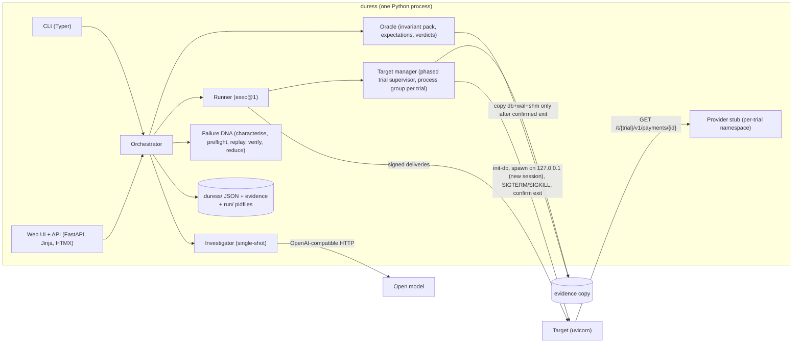

# Duress — Architecture & Implementation Plan (Revision 4, FROZEN for M0)

> Put your integrations under pressure. Keep the proof.

## R. Revision log

**Revision 4** is the final contract patch from the sign-off review. The architecture, scope and milestone structure are unchanged.

| # | Correction | Resulting contract | Validated by |
|---|---|---|---|
| P1 | Execution deadline vs verdict precedence | **Planned per-attempt timeouts** are attempt outcomes; they're validated against the schedule in advance and never abort a trial. **Exceeding the execution deadline** cancels unfinished work and sets `execution_deadline_exceeded`. Once interruption-independent violations have been checked, the flag forces INCONCLUSIVE `trial_timeout`, so a deadline-truncated trial can never PASS. The schedule validator keeps planned worst-case duration ≤ 25 s, so exceeding the deadline is always abnormal. | `test_evaluate_trial.py` precedence rows; `tests/integration/test_deadline.py` regressions DL-1 and DL-2 (M1) |
| P2 | Multiple-payment acknowledgement semantics | Each delivery has an **effect intent**: `capture_and_fulfil`, `order_duplicate` or `none`. INV-5 checks every 2xx against the delivery's intent; 2xx responses are never exempted globally. The target's **response vocabulary** is explicit: `processed`, or `duplicate` with scope `event`, `payment` or `order`. New scenario **S9** (second payment after fulfilment) declares the order-duplicate outcome. Local state is kept separate from provider state. INV-4 is unchanged. | Regressions MP-1, MP-2 and MP-3 (M0, M1, M2) |
| P3 | S5 dependency | The S5 template, typed parameters, fixtures and expectation move to **M2**, which comes before M3. `naive_fix`, differential evaluation and reduction stay in M4. | `tests/e2e/test_exhaustive_fallback.py` (M3) |
| P4a | Official deadline | **D = 2026-10-27 20:00 IST.** | §Context |
| P4b | Trial wall clock | Six bounded phases (prepare, readiness, execute, drain, kill-confirm, evaluate), each with its own timeout, plus a **65 s** trial watchdog. A trial starts only if ≥65 s of its operation's time remains. | `test_trial_phases.py` (M1), `test_limits.py` |
| P4c | Invariant pack in DNA | The DNA embeds the **complete** `payments-ref-v1` pack: every member with its definition and hash, plus a pack digest. Preflight checks it member by member, in both directions. Replay evaluates the whole pack. | `test_replay_preflight.py` (M2) |
| P4d | Integrity errors | Only a `UNIQUE` conflict on `fulfilments.order_id` or `fulfilments.payment_id` counts as a duplicate. Any other integrity error rolls back and returns 500 `integrity_error`. | `targets/razorpay_ref/tests/test_integrity_classification.py` (M0) |
| P4e | Docker gate | Explicit test file paths, plus `scripts/m0_gate.sh`, which asserts the exact number of tests collected. pytest exit codes 4 and 5 both fail the gate. | M0 gate |
| P4f | Bind addresses | Render serves on `0.0.0.0:$PORT`. Managed targets bind only to `127.0.0.1`, and the target manager refuses anything else. | `test_target_bind_loopback` (M1) |

**Revision 3 (retained):**
- C1: per-payment linkage.
- C2: confirmed termination, no process reuse.
- C3: execution-semantics identity and preflight.
- C4: reduction preserves concurrency.
- C5: empirical verify-fix statistics.
- C6: consistency rules.
- Full product scope.

**Revision 2 (retained):**
- B1: per-scenario expectations.
- B2: evaluation precedence.
- B3: six invariants.
- B4: SQLite and lifecycle contracts.
- B5: DNA replay semantics.
- B6: reduction that preserves identity.
- B7: staged verify-fix.
- B8: one limits module.

---

## Context and schedule anchor

Duress runs controlled webhook deliveries against an integration and judges business invariants on persisted state. It keeps portable Failure DNA, reduces it, and replays it to verify fixes. The repo is still empty, so **nothing has been measured**. Every number is an acceptance target, and every runtime claim is an assumption with a named experiment.

**Schedule:**
- **Official deadline D = Tuesday 2026-10-27 20:00 IST.**
- Planned implementation start **I = 2026-10-26 15:15 IST**, which gives **R = 28.75 h**.
- Milestones need 28 h, which leaves a **0.75 h buffer**.
- The release tail is anchored **backward from D**:
  - Feature freeze and M6 start: **D − 4.75 h (27 Oct 15:15)**.
  - Release candidate: **D − 0.75 h (27 Oct 19:15)**.
- If I slips, the slip comes out of the buffer first, then from the temporary fallbacks in F.3. It never comes out of M6.

---

## 0. Where I push back on the brief (unchanged)

- **Investigator:** single-shot structured call plus one repair retry. No tool loop.
- **Model's role:** chooses from a closed scenario library with bounded parameters. It never writes schedules, invariants or verdicts.
- **Duress storage:** JSON files.
- **Faults:** injected only at the controlled dependency and through the schedule.
- **Targets:** managed localhost targets only.
- **Explanations:** model text is labelled and citation-checked. Verdicts come from data alone.

**What differs from webhook tools:**
1. It judges persisted effects, not responses.
2. It controls interleaving.
3. It keeps reduced reproducers whose content is hashed.
4. Its source-grounded hypotheses are confirmed by execution.

---

## A. Architecture



**A.1 Components** (same boundaries as Revision 3):
- The **target manager** runs the phased trial supervisor (C.2.2). Each target gets its own session and process group, a pidfile, and confirmed termination of the group before state is handed over. It binds targets to `127.0.0.1` only.
- The **runner** implements `exec@1`.
- The **oracle** reads only a copied snapshot taken after confirmed exit.

**A.2 Persistence:**
- `.duress/investigations/`, `.duress/dna/`, `.duress/evidence/<trial_id>/` (kept for FAIL and INCONCLUSIVE trials).
- `.duress/run/<trial_id>.pid` holds pgid, start time and instance id, for the startup sweep.
- All writes are atomic.

**A.3 Stack:** Python 3.12, uv, FastAPI and uvicorn, Pydantic v2, httpx, Typer, Jinja2 with vendored HTMX, stdlib `sqlite3`, `tomllib` and `ast`, pytest and pytest-asyncio. Playwright for Python is a dev dependency for the UI end-to-end and accessibility checks. One Dockerfile.

**A.4 Deployment: Render.**
- A Docker web service. The container command is `duress serve --host 0.0.0.0 --port $PORT`; **only the public service binds 0.0.0.0.**
- Managed targets inside the container still bind `127.0.0.1` on ephemeral ports.
- Local `duress serve` defaults to `127.0.0.1`.
- Health check path `/api/health`.
- **Starter instance** recommended (D5).
- The filesystem is ephemeral. The showcase investigation and its DNA are committed under `showcase/` and baked into the image. Hosted runs are lost when the instance restarts, and the README says so.
- Model key and demo token are Render environment secrets.
- Hosted verification goes through the HTTP API (`smoke.sh`).
- **Public-demo safety:**
  - Bundled targets only.
  - Anonymous visitors can browse the showcase and start **cached** investigations.
  - Live and exhaustive runs, replay and verify-fix need the token.
  - One operation at a time (409 otherwise), 3 per IP per hour, 30 per day.
  - Every operation has a trial cap and a hard wall-time limit (C.14).

**A.5 Layout:**
```
src/duress/ limits.py models.py semantics/exec_v1.json profiles.py target.py provider_stub.py
            signing.py scenarios.py expectations.py runner.py oracle.py invariants/payments_ref_v1.py
            dna.py preflight.py replay.py verify.py reduce.py llm.py investigator.py orchestrator.py
            store.py cli.py web/
targets/razorpay_ref/ common/ vulnerable/ fixed/ naive_fix/ profile.toml tests/
targets/fixture_modes/app.py
tests/ m0/ unit/ integration/ e2e/   fixtures/llm/   showcase/   docs/ DECISIONS.md EVIDENCE.md
scripts/ m0_gate.sh measure.py smoke.sh portability.sh build_showcase.py   Dockerfile render.yaml
```

---

## B. Product scope

### B.1 Journeys (outcomes are acceptance targets)

**CLI:**
1. `duress investigate razorpay-vulnerable --mode cached` prints a hypothesis table showing citation, structure, linkage and outcome status, plus a scenario verdict table with valid, fail and inconclusive counts, and DNA ids.
2. `duress reduce <dna>` prints the reduction log and its claim.
3. `duress verify-fix <dna> --vulnerable razorpay-vulnerable --candidate razorpay-fixed` prints the staged result and the conditional statement.
4. `duress replay <dna>` works from a clean clone.

**Web:**
1. Choose a target and click Investigate. A progress view lists each scenario's trials as they finish.
2. The investigation page shows hypotheses with source excerpts and their four statuses, and the verdict table.
3. The DNA page shows the schedule timeline with effect intents, the release condition, the violating rows mapped to roles, p0, the control level, and the reduction diff.
4. A verify-fix panel shows control and candidate counts, the result and the conditional statement.
5. The DNA downloads as JSON.

### B.2 Scope

**Essential**, all with acceptance criteria in section D:
- Vulnerable, fixed and `naive_fix` targets, plus the fixture-mode target.
- Scenarios S1, S2, S3 (rendezvous, latency, black-box), S5, S6, S8, S9.
- Oracle with the full invariant pack.
- DNA characterisation, preflight, replay and verify-fix.
- **Reduction.**
- Investigator in live, cached and exhaustive modes, with a template explanation.
- **CLI and web UI.**
- Local container and Render deployment.
- Generated EVIDENCE.md and the README.

**Enhancement:** model-written explanation.

**Deferred:** S4 and S7, external targets, Postgres, other providers, a tool loop, multi-user, CI integration, model-proposed fixes, network fault proxies, process reuse.

**Exclusions** (stated in the README):
- PASS and VERIFIED are bounded empirical statements, not proofs.
- No global minimality.
- The reference defect is a seeded benchmark.

---

## C. Technical Contracts

### C.1 Target contract v1 and reference targets

**Target contract v1:**
- `python -m <pkg> init-db --db PATH --seed SEED.json`: creates the schema and seed, then exits.
- ASGI app `<pkg>.app:app`, launched by Duress with `--host 127.0.0.1 --port <ephemeral>`. Environment: `DATABASE_PATH`, `PROVIDER_BASE_URL`, `WEBHOOK_SECRET`, `DURESS_INSTANCE`.
- `GET /healthz` returns `{"instance": $DURESS_INSTANCE}`. The runner refuses a target whose instance doesn't match.
- `POST /webhooks/razorpay`.
- **Graceful drain:** on SIGTERM, stop accepting, finish in-flight requests, exit 0.
- No background work outlives a request.
- A schema compatible with pack `payments-ref-v1`.

**Response vocabulary.** Responses are observations. Verdicts come from the oracle; a response affects a verdict only through a scenario's required evidence and pass conditions.

| Response | Meaning |
|---|---|
| `200 {"status":"processed"}` | This delivery performed capture-and-fulfilment |
| `200 {"status":"duplicate","scope":"event"\|"payment"\|"order"}` | Acknowledged with no new effect: same event already seen, payment already processed, or order already fulfilled by another payment |
| `4xx {"status":"rejected","reason":…}` | 400 validation, 401 signature, 404 unknown entity, 409 invalid state |
| `5xx {"status":"error","reason":…}` | Including `integrity_error` |

A body that contradicts the delivery's effect intent is recorded as the observation `response_semantics_mismatch`. It's shown in the UI and is not a verdict.

**SQLite rules (all variants):**
- One connection per request: `connect(path, isolation_level=None, timeout=5)`, closed in `finally`. Never shared.
- WAL mode is set at `init-db`. Each connection sets `foreign_keys=ON` and `busy_timeout=5000`.
- **Rule R-TX: no `await` between `BEGIN` and `COMMIT` or `ROLLBACK`.**
- Two-worker soundness is tested separately (E8).

**Domain** (synthetic, explicit):
- `orders(id, amount, currency, status ∈ {created, fulfilled})`
- `payments(id, order_id, amount, currency, status ∈ {created, authorized, captured, failed})`. Several payments per order are allowed.
- `fulfilments(id, order_id, payment_id, amount, created_at)`
- **Local vs external state:**
  - `payments.status` is the **integration's local record**.
  - The provider stub's fixtures are the external truth. Neither Duress nor the target ever mutates them.
  - A 2xx acknowledgement only tells the sender to stop redelivering. **It changes nothing at the provider.**
- **Local `captured`** means the integration processed this payment's capture and fulfilled the order with it. Every locally captured payment has exactly one fulfilment with `f.payment_id = p.id AND f.order_id = p.order_id` (INV-4). An order has at most one fulfilment (INV-1).
- **Second payment for a fulfilled order:** if payment A2 arrives after order A was fulfilled by A1, the corrected integration replies `200 duplicate scope=order` and leaves A2's **local** row unchanged. A2 can still be captured at the provider; refunds and reconciliation are out of scope and not modelled.

**Vulnerable variant** (one defect: non-atomic check-then-act):
- T1, autocommit: read the payment and order status.
  - Payment already captured → `200 duplicate scope=payment`.
  - Order already fulfilled → `200 duplicate scope=order`.
- `await provider.fetch_payment` happens outside any transaction. A mismatch returns 400.
- T2: `BEGIN; INSERT fulfilment; UPDATE payment captured; UPDATE order fulfilled; COMMIT` → `200 processed`.
- No UNIQUE constraint on `fulfilments`.
- Handles `payment.captured` and `order.paid` (which carries the payment id).
- Sequential second payments are handled correctly; concurrent deliveries race between T1 and T2.

**Fixed variant:**
```
fetch + validate (400 on mismatch)
BEGIN IMMEDIATE
  existing = SELECT payment_id FROM fulfilments WHERE order_id=:oid
  existing → ROLLBACK → 200 duplicate (scope = payment if existing == pid else order)   # A2 left unchanged
  rc = UPDATE payments SET status='captured'
        WHERE id=:pid AND order_id=:oid AND status IN ('created','authorized')
  rc == 0 → ROLLBACK → 404 (unknown payment) | 409 (invalid state)
  INSERT fulfilment        -- UNIQUE(order_id), UNIQUE(payment_id): database-level guarantee
  UPDATE orders SET status='fulfilled' WHERE id=:oid AND status='created'
COMMIT → 200 processed
IntegrityError → ROLLBACK, then:
  intended duplicate  ⇔ e.sqlite_errorname == "SQLITE_CONSTRAINT_UNIQUE"
                        and message ∈ {"UNIQUE constraint failed: fulfilments.order_id",
                                       "UNIQUE constraint failed: fulfilments.payment_id"}
                      → 200 duplicate (same scope rule)
  anything else (FK, CHECK, NOT NULL, other UNIQUE) → 500 {"status":"error","reason":"integrity_error"}
```
- The pre-check is race-free because `BEGIN IMMEDIATE` holds the write lock.
- The UNIQUE constraints remain the guarantee for every code path.

**`naive_fix` variant:** inserts `webhook_events(event_id PK)` first (repeat event → `200 duplicate scope=event`); otherwise identical to vulnerable.

**Fixture-mode target** (`FIXTURE_MODE`), used only for oracle and verify-fix controls:

| Mode | Behaviour |
|---|---|
| `no_sig_check` | Mutates on an invalid signature |
| `ack_without_effect` | Returns `200 processed` without writing |
| `reject_all` | Returns 400 for everything |
| `crash_on_boot` | Exits immediately |
| `hang_on_shutdown` | Ignores SIGTERM |
| `dup_then_hang` | Double-fulfils, then ignores SIGTERM |
| `spawn_orphan` | Starts a child process that tries to write to the DB after SIGTERM |
| `mark_duplicate_captured` | On an order duplicate, sets the second payment's local status to `captured` without a fulfilment, then returns `200 duplicate scope=order` |

### C.2 Execution semantics and trial lifecycle

**C.2.1 Execution semantics `exec@1`.** Declared in `src/duress/semantics/exec_v1.json`. Identity is `exec@1#sha256(canonical spec)`. Any change needs a version bump. `tests/unit/test_exec_semantics.py` has one conformance test per clause.
1. **Steps** run strictly in order. Step k+1 starts `delay_before_ms` after every attempt of step k has resolved.
2. **Concurrent group:** every first-attempt request is built, then one `asyncio.Event` releases them all. Send order is unspecified.
3. **Attempts:** `attempt_timeout_ms` is a **planned** client-side total timeout. On expiry the connection is closed and the attempt outcome is `timeout`. This is a normal outcome and never aborts the trial.
4. **Retries:** attempt n+1 is sent `backoff_ms[n]` after attempt n resolves, if its outcome is in `retry_on`. Same body and event id; signature regenerated.
5. **Planned duration:** the schedule validator computes the worst case W = Σ over steps of (`delay_before_ms` + the maximum over the step's deliveries of Σ over attempts of (`attempt_timeout_ms` + `backoff_ms`)). **It requires W ≤ 25 s**, below the 30 s execution deadline.
6. **Execution deadline (30 s):** if it passes before every planned attempt has been dispatched and resolved, the runner cancels in-flight attempts, dispatches nothing further, and records `execution_deadline_exceeded=true`, `cancelled_attempts` and `undispatched`.
7. **Signing:** HMAC-SHA256 hex over the exact body bytes with the secret resolved from `secret_ref`. An invalid signature uses the key `sha256("duress-invalid:" + delivery_id)`.
8. **Stub fixtures:** `GET /t/{trial}/v1/payments/{id}` returns the fixture as 200 JSON, or 404 for an unknown id. Any other prefix returns 410, recorded as a `stale_call`.
9. **Latency fault:** each matching call is delayed by `ms`.
10. **Rendezvous fault:** matching calls are held until `parties` have arrived (`released_by=parties`) or `timeout_ms` has passed since the first arrival (`released_by=timeout`). Everything held is released at once. Later calls aren't held.
11. **Expectation vocabulary v1:** the evidence kinds, `exactly_once(order, payment)`, `payment_unchanged(payment)`, and the pass-condition kinds used in C.5.
12. **Settlement:** follows C.2.2.

**C.2.2 Phased trial supervisor (P4b, C2).** Each phase has its own timeout, and a **65 s watchdog** covers the whole trial.

| Phase | Work | Bound | Timeout outcome |
|---|---|---|---|
| P1 Prepare | Allocate `trial_id` (= `DURESS_INSTANCE`), fresh temp dir and port; `init-db`; check the baseline equals the seed; probe the schema; configure the stub namespace | 5 s | INCONCLUSIVE `harness:prepare_timeout`. Nothing spawned |
| P2 Readiness | Spawn with `start_new_session=True` on `127.0.0.1`; write the pidfile; health must return the matching instance | 10 s | INCONCLUSIVE `target_unavailable`, then P4–P5 |
| P3 Execute | Run the schedule under `exec@1`; watch the group; quiesce the harness (attempts resolved, stub holding nothing). **Harness quiescence never counts as target quiescence** | 30 s (execution deadline) | Clause 6: flag set, continue to P4 |
| P4 Drain | SIGTERM to the group; wait for the leader to exit | 10 s | SIGKILL, then P5; settlement `forced` |
| P5 Kill and confirm | SIGKILL if needed; confirm no process remains (`killpg(pgid, 0)` raises `ProcessLookupError`) | 5 s | Settlement `unconfirmed`: **state not read**, operation aborted, diagnostics kept; no further trials until a sweep |
| P6 Evaluate | Copy db, `-wal` and `-shm`; open the copy; snapshot; C.6; remove the pidfile | 5 s | INCONCLUSIVE `harness:evaluation_timeout`, evidence kept |

- **Settlement values:**
  - `clean`: exit 0 within P4 and the group gone.
  - `drain_unverified`: like clean, but attempts were abandoned and E3 didn't verify draining.
  - `forced`.
  - `crashed`: the leader exited before P4; the group was then killed and confirmed.
  - `unconfirmed`.
- If the watchdog fires during any phase, it jumps to P4–P5 and the trial is INCONCLUSIVE `harness:watchdog`.
- Temp directories, ports and stub namespaces are never reused.

**Duress cancellation and crashes:**
- `try/finally` and SIGINT/SIGTERM handlers run P4–P5 for every registered group.
- At startup, `duress` sweeps `.duress/run/*.pid`, killing any group whose recorded start time and instance still match.
- A leaked process can't contaminate a later trial: different DB path, different port (instance check), different stub namespace (`stale_call` makes the trial INCONCLUSIVE).

**Validity effects:**

| Event | Effect |
|---|---|
| Planned attempt timeout | Valid attempt outcome. S6 depends on it. Never sets the deadline flag |
| 5xx or connect error | Valid, unless the target exited (then `crashed`) |
| Execution deadline exceeded | `execution_deadline_exceeded=true`; C.6 step 5 |
| `stale_call` | INCONCLUSIVE `harness:isolation` |
| Rendezvous released by timeout | Valid; release condition recorded |

### C.3 Control levels

| Level | Definition |
|---|---|
| `black_box` | **No faults.** The stub answers immediately. Concurrency comes only from the group gate |
| `environment_controlled` | Any `provider_latency` or `provider_rendezvous` fault |
| `instrumented` | Only the M0 fallback: an environment-guarded sync point, labelled |

Rates are reported per level. Latency-fault runs are never black-box.

### C.4 Invariant pack `payments-ref-v1`

**How the pack works:**
- Each member returns violation rows `{check_id, kind, entity_ids}`.
- **Member identity:** `id@version#sha256(canonical{id, version, kind, sql, flags, evaluator_source_sha256})`.
- **Pack identity:** `payments-ref-v1@1#sha256(canonical(sorted member identities))`.
- `independent=true` means an interrupted process cannot cause the violation.
- **Every trial evaluates the whole pack.**

| ID | Detects | Definition | independent |
|---|---|---|---|
| INV-1 `single_fulfilment` | Duplicate fulfilment | `GROUP BY order_id HAVING COUNT(*)>1` → `duplicate_fulfilment` | yes |
| INV-2 `references_and_ownership` | Missing references, wrong ownership | Fulfilment with a missing order or payment; payment with a missing order; `p.order_id ≠ f.order_id` → `missing_reference` / `ownership_mismatch` | yes |
| INV-3 `capture_and_amounts` | Fulfilment without local capture; wrong amounts | For each fulfilment, through its `payment_id`: `p.status≠'captured'`, `f.amount≠o.amount`, `p.amount≠o.amount`, `p.currency≠o.currency` → `uncaptured_fulfilment` / `amount_mismatch` | no |
| INV-4 `state_consistency` | Invalid states, partial completion | Status outside its enum → `invalid_state`. A locally captured payment `p` with no `f` where `f.payment_id=p.id AND f.order_id=p.order_id` → `captured_without_fulfilment`. A fulfilled order without a fulfilment, or a fulfilment whose order isn't fulfilled → `order_status_inconsistent` | no |
| **INV-5** `ack_matches_intent` | Acknowledgement inconsistent with the delivery's intent | For each attempt with a 2xx: **`capture_and_fulfil`** → its payment is locally captured **and** linked to a fulfilment (`payment_id` with matching order); otherwise `ack_without_effect`. **`order_duplicate`** → its order has a fulfilment linked to a **different** payment **and** this payment's row equals the baseline; otherwise `duplicate_ack_inconsistent`. **`none`** → not checked by INV-5 (footprint and pass conditions apply) | no |
| INV-6 `authorized_footprint` | Unauthorized or cross-entity mutation | Rows for order roles outside the footprint differ from the baseline; any row referencing an unseeded order → `unauthorized_mutation` | yes |

- **Expected effects:**
  - `exactly_once(order:X, payment:Y)`: one fulfilment for X, linked to Y; Y locally captured; X fulfilled.
  - `payment_unchanged(payment:Z)`: Z's row equals the baseline.
  - A miss is `expected_effect_missing`. Not independent.
- **Signature precedence:** INV-1 > INV-6 > INV-2 > INV-3 > INV-4 > INV-5 > expected effect.
- **Failure signature:** `(check@version, kind, sorted roles)`, with roles such as `order:A`, `payment:A1` and `payment:A2`.
- **Required fixtures** (`tests/unit/test_invariants.py`): one violating and one clean but tricky fixture per member, plus:

| Fixture | Expected |
|---|---|
| `two_captured_one_fulfilment`: A1 and A2 both locally captured, one fulfilment linked to A1 | INV-4 `captured_without_fulfilment` on `payment:A2` (**MP-2**) |
| `second_payment_preserved`: A1 captured and fulfilled; A2 authorized and equal to the baseline; d2 acknowledged with intent `order_duplicate` | Clean (**MP-1**, database level) |
| `second_payment_mutated`: as above, but A2's row changed | INV-5 `duplicate_ack_inconsistent` |
| `first_capture_acked_no_effect`: d1 with intent `capture_and_fulfil` got a 2xx; no capture, no fulfilment | INV-5 `ack_without_effect` (**MP-3**, database level) |
| `failed_then_captured` | Clean |
| `fulfilment_linked_to_other_orders_payment` | INV-2 |
| `amount_equal_order_but_payment_differs` | INV-3 |

### C.5 Scenario expectations

Every delivery declares an **effect intent**: `capture_and_fulfil`, `order_duplicate` or `none`.

| Scenario | Schedule (intent) | Required evidence | Expected effects | Footprint | Extra pass condition |
|---|---|---|---|---|---|
| S1 | d1 `payment.captured` A (c&f) | d1 answered | `exactly_once(A, A)` | {A} | — |
| S2 | d1, then the same event as d2 (both c&f) | Both answered; send(d2) > end(d1) | `exactly_once(A, A)` | {A} | — |
| S3 | Group of `copies`∈[2,10] same-event deliveries for A (c&f). `fault`∈{`rendezvous` (parties = copies), `latency{ms}`, `none`} | Group overlap; at least one response | `exactly_once(A, A)` | {A} | — |
| S5 | Group of `payment.captured` + `order.paid`, both for payment A (c&f). `fault`∈{`rendezvous` (parties 2), `latency{ms}`, `none`} | Overlap | `exactly_once(A, A)` | {A} | — |
| S6 | Latency L > attempt timeout t; retry on timeout (c&f) | Attempt 1 `timeout` and attempt 2 dispatched | `exactly_once(A, A)` | {A} | — |
| S8 | d1 to A with the derived invalid signature (none), then d2 to B (c&f) | d1 answered; d2 got 2xx | `exactly_once(B, B)` | {B} | d1 status is 4xx |
| **S9** `second_payment_after_fulfilment` | d1 `payment.captured` A1 (c&f), then d2 `payment.captured` A2 (**order_duplicate**) after d1's response. Seed: A1 and A2 authorized; provider fixtures: both captured externally | Both answered; send(d2) > end(d1) | `exactly_once(A, A1)`, `payment_unchanged(A2)` | {A} | d1 and d2 both 2xx (otherwise `duplicate_not_acknowledged`); body `duplicate scope=order` for d2 is recorded and a mismatch is noted |

- **S8 outcomes:**
  - **PASS:** d1 4xx, A unchanged, B fulfilled exactly once.
  - **FAIL:** any mutation of A (INV-6) or any other violation.
  - **INCONCLUSIVE:**
    - `rejection_unobserved`: no response or a 5xx.
    - `accepted_without_effect`: 2xx and no change.
    - `control_failed_to_execute`: d2 didn't get a 2xx.
- **Party-count rule:** the validator rejects any rendezvous whose `parties` differs from the number of matching deliveries in its group.
- **Defaults**, fixed before M0:
  - S3 `copies=3`.
  - S5 rendezvous.
  - S6 L 2000 ms, t 1000 ms, `max_attempts=2` (W ≈ 2.2 s).
  - S9 no faults.

### C.6 Trial evaluation and aggregation (P1)

```
evaluate_trial
 1. harness error | stale_call | baseline/instance mismatch | watchdog | settlement=unconfirmed → INCONCLUSIVE(harness:*)
 2. target never ready                                                                   → INCONCLUSIVE(target_unavailable)
 3. snapshot unreadable / schema probe fails (any settlement)                            → INCONCLUSIVE(state_unreadable|schema_mismatch); evidence kept
 4. violations of independent pack members                                               → FAIL  (attributable committed state; holds under
                                                                                                  deadline/forced/crashed; flags recorded)
 5. execution_deadline_exceeded                                                          → INCONCLUSIVE(trial_timeout)   # never PASS
 6. settlement ∈ {forced, crashed, drain_unverified}                                     → INCONCLUSIVE(settlement:*)
 7. required evidence unmet                                                              → INCONCLUSIVE(insufficient_evidence:*)
 8. any pack violation or expected-effect miss                                           → FAIL
 9. scenario pass condition unmet                                                        → INCONCLUSIVE(named)
10.                                                                                      → PASS
```

**Aggregation** for a policy `{r, a = max(1, ⌊0.1·r⌋), max = r + a}`:
- Trials continue until there are r valid ones, max attempts are reached, or the operation's remaining-time check (≥65 s) fails.
- **FAIL:** at least one FAIL. Inconclusive trials never downgrade an attributable FAIL.
- **PASS:** no FAIL, **valid ≥ r**, inconclusive ≤ a.
- **INCONCLUSIVE:** anything else, including `budget_exhausted`.

| Policy | r | max | Used by |
|---|---|---|---|
| `explore` | 5 | 6 | Investigation scenarios |
| `characterize` | 10 | 11 | Before writing a DNA; black-box characterisation |
| `reduce` | 3 | 4 | Reduction candidates |
| `replay` | 10 | 11 | `replay`; reduced-DNA re-validation |
| `verify_control` | 5, or 10 if p0<0.9 | 6 / 11 | verify-fix stage 2 |
| `verify_candidate` | n_c | n_c + max(1,⌊0.1·n_c⌋) | verify-fix stage 3 |
| `matrix` | 20 | 22 | Evidence suite |

### C.7 Schemas (changes in Revision 4)

- `Delivery.effect_intent ∈ {capture_and_fulfil, order_duplicate, none}` replaces `expect_effect`.
- `AttemptRecord.outcome ∈ {response, timeout, connect_error, cancelled}`, plus `response_body_status` and `response_body_scope`.
- `TrialObservation` gains `execution_deadline_exceeded`, `cancelled_attempts`, `undispatched`, `phase_timings` (P1–P6), and `response_semantics_mismatches`.
- `Schedule` validators: the party-count rule and W ≤ 25 s.
- `InvariantPack{id, version, digest, members[]}`.
- Retained from Revision 3:
  - `TrialObservation.stub.release`.
  - `settlement`.
  - `instance_ok`.
  - `Seed.roles` (orders and payments).
  - `Investigation.mode_effective` and `fallback_reason`.
  - Replay `REJECTED(reason)`.

### C.8 Scenario library

- **Registry** (`scenarios.py`): S1, S2, S3, S5, S6, S8, S9. Each is `build(params, roles) → (Schedule, Expectation, ProviderFixtures)` and declares `addresses` and `observable_checks`.
- **`EXHAUSTIVE_SET`** (seven): S1, S2, S3-rendezvous, S3-`latency{200}`, S5, S6, S8.
- S9 is a domain-semantics scenario. The investigator can select it, and it runs in the matrix and in verify suites. It isn't in `EXHAUSTIVE_SET`, which keeps the explore budget at 7 × 6.
- Deferred: S4 and S7.
- No padding.

### C.9 Failure DNA v1

```json
{
  "schema_version": 1,
  "dna_id": "reproducer_sha256[:16]",
  "reproducer_sha256": "sha256(canonical(reproducer))",
  "reproducer": {
    "domain": "payments-webhook",
    "execution_semantics": {"id": "exec", "version": 1, "digest": "sha256(exec_v1.json canonical)"},
    "target_contract": {"profile": "razorpay-ref", "contract_version": 1, "process": {"workers": 1}},
    "seed": {"roles": {"order:A": "order_001", "payment:A": "pay_001"}, "tables": {}},
    "provider_fixtures": [],
    "signing": {"scheme": "hmac-sha256-hex", "header": "X-Razorpay-Signature",
                "event_id_header": "X-Razorpay-Event-Id", "secret_ref": "env:DURESS_WEBHOOK_SECRET"},
    "schedule": {"events": [], "deliveries": [{"id": "d1", "effect_intent": "capture_and_fulfil"}],
                 "steps": [], "faults": [], "delivery_policy": {}},
    "expectation": {"id": "S3.exactly_once", "version": 1, "definition_sha256": "…", "definition": {}},
    "invariant_pack": {"id": "payments-ref-v1", "version": 1, "digest": "…",
                       "members": [{"id": "INV-1", "version": 1, "definition_sha256": "…", "definition": {}},
                                   "… all six members …"]},
    "failure_signature": {"check": "INV-1@1", "kind": "duplicate_fulfilment", "roles": ["order:A"]},
    "release_condition": "parties | timeout | none",
    "control_level": "environment_controlled",
    "trial_policy": {"replay": {"required_valid": 10}}
  },
  "provenance_scenario": {"template_id": "S3", "template_version": 1, "params": {}},
  "environment": {"duress_version": "", "python": "", "sqlite": "", "platform": "", "target_source_sha256": ""},
  "characterization": {"p0": 1.0, "valid": 10, "release_conditions": {"parties": 10}, "black_box_rate": "k/n"},
  "observations": {"violation_rows": [], "attempts": [], "evidence_ref": ""},
  "reduction": null,
  "provenance": {"investigation_id": "", "hypothesis_id": null, "reduced_from": null, "created_at": ""}
}
```

- **Identity:** the full SHA-256 of the reproducer is stored; `dna_id` is its prefix.
- **Integrity, not authenticity:** the digest detects alteration but doesn't prove who made the artifact (documented).
- **Secrets:** none stored. Signatures are regenerated at runtime from `secret_ref`.

### C.10 Replay, preflight and verify-fix

**Preflight** runs **before any target starts**. The first failure returns **`REJECTED(reason)`** with exit code 4:

| # | Check | Rejection reason |
|---|---|---|
| 1 | Parses; `schema_version` supported | `unsupported_version` |
| 2 | sha256(canonical(reproducer)) equals `reproducer_sha256`; `dna_id` is its prefix | `tampered:digest` |
| 3 | Embedded expectation definition hashes to its `definition_sha256` / equals the local registry entry for (id, version) | `tampered:expectation` / `incompatible:expectation` |
| 4 | **Invariant pack.** Each embedded member's definition hashes to its `definition_sha256`, and the pack digest recomputes (else `tampered:invariant_pack`). Pack (id, version) is supported, each member equals the local registry, and the local pack has no member missing from the DNA (else `incompatible:invariant_pack`). `failure_signature.check` is in the pack or the expectation | as stated |
| 5 | `execution_semantics` (id, version, digest) supported by this runner | `incompatible:execution_semantics` |
| 6 | Target profile implements `contract_version`; `init-db` plus schema probe pass in a scratch directory | `incompatible:target_contract` / `schema_mismatch` |
| 7 | Schedule passes validators and limits (party count, W ≤ 25 s, effect intents present) | `invalid:schedule` |
| 8 | `secret_ref` resolves | `secret_unresolved` |

**Replay outcomes** (whole pack evaluated):
- `REPRODUCED`: at least one FAIL with the same signature.
- `NOT_REPRODUCED`: the policy's PASS quota is met.
- `DIFFERENT_FAILURE`.
- `INCONCLUSIVE`.
- `REJECTED`.

**verify-fix** is an empirical verification criterion, not a correctness proof:
1. Preflight against V and F.
2. **Control on V** (`verify_control`). k = same-signature fails, v = valid trials, p̂ = k/v.

   | Condition | Result |
   |---|---|
   | v < r | INCONCLUSIVE `control_insufficient_valid` |
   | k = 0 | INCONCLUSIVE `control_not_reproduced` |
   | p̂ < p0/2 | INCONCLUSIVE `control_degraded` |

3. **Candidate size:** p_a = min(p̂, 0.99). n_c = max(20, ⌈ln 0.01 / ln(1 − p_a)⌉). If n_c > 44: INCONCLUSIVE `reproduction_too_unreliable`.
4. **Candidate on F** (`verify_candidate`, stopping at the first same-signature FAIL):

   | Condition | Result |
   |---|---|
   | Any FAIL with the original signature | **NOT_VERIFIED** `still_reproduces` |
   | Any other FAIL | **NOT_VERIFIED** `other_violation` |
   | valid < n_c, inconclusive > a, or deadline reached | **INCONCLUSIVE** `candidate_insufficient_valid` / `budget_exhausted` |
   | Otherwise | **VERIFIED** |

   FAIL outcomes take precedence over an incomplete run.

5. **Statement:** "S reproduced in k/v valid control trials on V. Not observed in n_c valid trials on F under the same DNA conditions. *If* F still failed independently with per-trial probability p_a, the chance of seeing no failures in n_c valid trials would be (1−p_a)^n_c ≤ 1%. Under the same independence assumption, ≈3/n_c is an approximate 95% upper bound on F's per-trial failure probability for this reproducer. This does not establish correctness for other schedules, loads or environments."

### C.11 Reduction (essential, bounded)

**Preconditions:** p0 ≥ 0.9, and every valid characterisation trial has the same release condition. Otherwise the result is `skipped: mixed_release` or `skipped: p0<0.9`.

**Operation:** remove one delivery; drop steps left empty. Each remaining delivery keeps its effect intent.

**Static constraints.** A candidate that fails any of these is inadmissible and runs no trials:
- (a) The signature's roles are still targeted by a delivery whose intent isn't `none`.
- (b) A concurrent group on the affected role keeps at least 2 deliveries.
- (c) Faults, delivery policy, fixtures, seed, expectation and invariant pack are unchanged.
- (d) Party-released originals keep at least `parties` matching deliveries; `parties` itself never changes.
- (e) The schedule still passes C.7's validators.

**Predicate** (`reduce` policy, r = 3):
- **Accept** if all 3 valid trials FAIL with the identical signature **and** each records the original release condition:
  - Party-released: `released_by=parties` with arrivals ≥ `parties`.
  - Timeout-released: `released_by=timeout`.
  - No rendezvous: nothing extra.
- **Reject** on any PASS, a different signature, or a different release condition.
- **Unknown** if fewer than 3 valid trials; treated as reject and recorded.

**Algorithm:** greedy single-delivery removal in reverse order, restarting the pass after each acceptance. Budget: C_max = 10 admissible candidates (≤40 trials).

**Claims:**

| Situation | Claim |
|---|---|
| Every admissible candidate tested, none unknown | `"1-minimal w.r.t. admissible single-delivery removal under P (r=3, all-fail, release-preserving)"` |
| No admissible candidates exist | `"no admissible reductions"` |
| Otherwise | `"reduced; 1-minimality not established"` |

**Re-validation:** `replay` on the reduced DNA must reach p ≥ 0.9 with a uniform release condition, otherwise the original stays primary.

**Characterisation experiment:** re-run the original without faults under `characterize` and record `black_box_rate`.

### C.12 Investigator

- **Hypothesis schema** (unchanged): mechanism citations; `predicted_failure{check, kind, role}`; scenarios; four statuses (citation, structure, linkage, outcome).
- **Structure check:** `ast`-based, for `check_then_act_race`.
- Only a hypothesis with `outcome: confirmed` is presented as a model finding.

**Modes:**

| Requested | Behaviour | Falls back to exhaustive when |
|---|---|---|
| `live` | One JSON-mode call plus at most one repair call, 60 s each | `transport_error`, `invalid_output`, `no_usable_hypotheses` |
| `cached` | Fixture keyed by sha256(model + prompt); no network | `cache_miss`, `no_usable_hypotheses` |
| `exhaustive` | Runs `EXHAUSTIVE_SET` (7) from the real registry; template explanation | — |

- `no_usable_hypotheses` means zero hypotheses with valid citations **and** valid linkage. Rejected hypotheses stay visible.
- **Selection:** S1 and S2 as controls, plus the model's picks from the registry, ≤7 scenarios in total.
- **Limits:** ≤3 model calls, ≤30k input tokens, 120 KB bundle, allowlist only.

### C.13 API and CLI

**API:**
- `GET /api/health`, `GET /api/targets`
- `POST /api/investigations {target_id, mode}` → 202 / 409 / 401 / 429
- `GET /api/investigations[/{id}]`
- `GET /api/dna/{id}`
- `POST /api/dna/{id}/replay`
- `POST /api/dna/{id}/reduce`
- `POST /api/dna/{id}/verify-fix`
- **Pages:** `/`, `/investigations/{id}`, `/dna/{id}`

**CLI:** `targets · run · investigate --mode live|cached|exhaustive · replay · reduce · verify-fix · report · serve [--host, default 127.0.0.1] [--port] · sweep`. Exit codes:

| Code | Meaning |
|---|---|
| 0 | PASS / VERIFIED / NOT_REPRODUCED |
| 1 | FAIL / NOT_VERIFIED / REPRODUCED / DIFFERENT_FAILURE |
| 2 | INCONCLUSIVE |
| 3 | Usage error |
| 4 | REJECTED |

### C.14 Limits (`src/duress/limits.py`; `tests/unit/test_limits.py` checks every derived total)

| Limit | Value |
|---|---|
| Deliveries per schedule / group size / attempts per delivery | ≤10 / ≤10 / ≤3 |
| Attempt timeout / planned schedule worst case W / execution deadline | ≤10 s / **≤25 s** / 30 s |
| **Trial phases** | P1 5 s + P2 10 s + P3 30 s + P4 10 s + P5 5 s + P6 5 s = **65 s hard wall** (watchdog) |
| Investigation trials | ≤130: explore 7×6 (42) + characterise ≤2 signatures × 11 (22) + black-box characterisation 11 + reduction 10×4 (40) + re-validation 11 = **126** |
| verify-fix operation | Control ≤11 + candidate ≤48 = **≤59 trials** |
| Replay / reduce operations | ≤11 / ≤40 + 11 |
| HTTP attempts | ≤30 per trial (retries included). Investigation ≤3,900. verify-fix ≤1,770 |
| Deadline enforcement | A trial starts only if ≥65 s of the operation remain; otherwise `budget_exhausted`. Investigation wall = 130 × min(t_p95, 65 s) + 180 s for model calls |
| M0 budget adjustment | t_p95 > 2 s: explore r=3 (max 4), C_max=6. No process reuse |
| Model | ≤3 calls, ≤30k tokens, 60 s each |
| Hosted | 1 concurrent, 3/IP/hour, 30/day; anonymous users get cached mode only |

---

## D. Milestones

Times assume I = 26 Oct 15:15 IST. M6 is anchored backward from D.

```mermaid
gantt
  dateFormat X
  axisFormat %s
  section Critical path
  M0 Reproducible defect + local container :m0, 0, 3.5
  M1 Trustworthy oracle + isolation        :m1, after m0, 5.5
  M2 Library, preflight, replay, verify, Render :m2, after m1, 4.5
  M3 Investigator                          :m3, after m2, 4
  M4 Reduction + naive_fix + differential  :m4, after m3, 3
  M5 Web UI + full CLI                     :m5, after m4, 3.5
  M6 Release (anchored D−4.75)             :m6, after m5, 4
  Buffer                                   :b, after m6, 0.75
```



| Milestone | Window (IST) |
|---|---|
| M0 | 26 Oct 15:15–18:45 |
| M1 | 18:45–00:15 |
| M2 | 27 Oct 00:15–04:45 |
| M3 | 04:45–08:45 |
| M4 | 08:45–11:45 |
| M5 | 11:45–15:15 |
| M6 | 15:15–19:15 |
| Buffer | 19:15–20:00 |

### M0: Reproducible defect (I → I+3.5)

- **Scope:**
  - `git init`, uv, the Dockerfile.
  - `targets/razorpay_ref`: vulnerable and fixed, `init-db`, the response vocabulary, the integrity classifier.
  - Target test suite.
  - A minimal stub (latency, rendezvous, namespace).
  - `tests/m0/`: its own small harness covering process group, confirmed exit, DB copy and direct SQL. **No engine code.**
  - `scripts/m0_gate.sh`.
- **Target test suite** (`targets/razorpay_ref/tests/`, runs against both variants):
  - Single capture → `processed`, 1 linked fulfilment.
  - Sequential duplicate → `duplicate scope=payment`, still 1.
  - Invalid signature → 401, no change.
  - Amount mismatch → 400, no change.
  - **MP-1, sequential:** A1 processed, then A2 → `200 duplicate scope=order`. One fulfilment linked to A1; A2 equals the baseline.
  - `test_integrity_classification.py` (fixed schema, real in-memory SQLite errors):
    - Duplicate `order_id` and duplicate `payment_id` → duplicate.
    - FK, CHECK, NOT NULL, and a UNIQUE conflict on a non-fulfilment table → not a duplicate. The handler returns 500 `integrity_error`.
- **M0 trial validity:** instance-matched readiness, every attempt answered, exit 0 within 10 s with the group confirmed gone. Up to 2 replacement trials per gate.

| ID | File | Experiment | Type |
|---|---|---|---|
| E1 | `tests/m0/test_e1_vulnerable_race.py` | Vulnerable, 2 copies, rendezvous (parties 2, timeout 2000 ms) | **gate** (1 test) |
| E2 | `tests/m0/test_e2_fixed_exactly_once.py` | Fixed, parametrised copies/parties 2/2 and 5/5 | **gate** (2 tests) |
| E3 | `tests/m0/test_e3_drain.py` | Latency 2 s, SIGTERM 0.5 s after dispatch, 10 valid trials | **gate** (1 test) |
| E4 | `tests/m0/test_e4_disconnect.py` | Attempt timeout 0.3 s, latency 1 s, 10 trials: is the effect committed? | measured |
| E5a | `tests/m0/test_e5_rates.py` | Black-box (no faults), 2 copies, 20 trials | measured |
| E5b | `tests/m0/test_e5_rates.py` | Latency 50 / 200 ms, 2 copies, 20 each | measured |
| E6 | `tests/m0/test_e6_timing.py` | Phase timings P1–P6, trial p50 / p95 | measured |
| E7 | — | Gate files inside `docker run` | **gate** |

- **Fallbacks:**
  - E1 still failing at I+5 (20:15): environment-guarded sync point, labelled `instrumented`.
  - E3 failing: make the reference targets meet the drain contract. Until then, attempts that were abandoned give `drain_unverified`, so S6 is temporarily blocked. No settlement by responses or grace.

### M1: Trustworthy oracle and isolation (I+3.5 → I+9)

- **Scope:**
  - Limits, models (including effect intents), the `exec@1` spec and runner (deadline clause).
  - The phased trial supervisor with sweep and the loopback guard.
  - Isolated stub, signing.
  - Full invariant pack (INV-5 by intent), expectations including `payment_unchanged`, `evaluate_trial`, aggregation.
  - Fixture-mode target.
  - Templates S1, S2, S3, S8.
  - `duress run`, `duress sweep`.
- **Acceptance:**
  - `test_invariants.py` covers every member and every C.4 fixture, including **MP-2** (`two_captured_one_fulfilment`), `second_payment_preserved`, `second_payment_mutated` and **MP-3** (`first_capture_acked_no_effect`).
  - `test_evaluate_trial.py` has one test per C.6 step, including:
    - Deadline flag with no violation → `trial_timeout` (never PASS).
    - Deadline flag with an independent violation → FAIL.
    - `dup_then_hang` → FAIL.
    - `hang_on_shutdown` → `settlement:forced`.
    - Corrupted forced-stop copy → `state_unreadable`.
    - `unconfirmed` → aborted.
  - **`tests/integration/test_deadline.py`.** The test uses an execution deadline override of 2 s and an S6-style schedule built with a validator override:
    - Step 1: concurrent group of 2 for A (rendezvous, parties 2).
    - Step 2: concurrent group of 2 for B with latency 5 s.

    | ID | Target | Expected |
    |---|---|---|
    | **DL-1** | fixed | Step 2 is cut off. Drain is clean, there's no violation, and the result is **INCONCLUSIVE `trial_timeout`**, not PASS |
    | **DL-2** | vulnerable | The duplicate fulfilment for A is committed before the deadline. **FAIL INV-1**, with `execution_deadline_exceeded` recorded |
    | DL-3 | any | S6 at its defaults: planned attempt timeouts never set the flag |

  - `test_trial_phases.py`:
    - Each phase timeout gives its stated outcome.
    - The watchdog fires at 65 s.
    - A schedule with W > 25 s is rejected.
  - `test_aggregate.py`, `test_exec_semantics.py`, `test_schedule_validation.py` (party count, W, intents).
  - `test_isolation.py`:
    - `spawn_orphan` leaves no process, and its write never reaches the snapshot.
    - SIGINT cleanup.
    - Pidfile sweep.
    - Stale call → INCONCLUSIVE.
    - Wrong instance refused.
    - **`test_target_bind_loopback`:** the target manager rejects a host other than `127.0.0.1`, and the running target isn't reachable on a non-loopback interface.
  - `test_matrix_fast.py` (explore policy): vulnerable S3-rendezvous FAIL; fixed S1, S2, S3, S8 PASS; vulnerable S1, S2, S8 PASS.
  - `test_controls.py`:

    | Fixture mode + scenario | Expected |
    |---|---|
    | `no_sig_check` + S8 | FAIL INV-6 |
    | **MP-3:** `ack_without_effect` + S1 | FAIL INV-5 `ack_without_effect` |
    | `reject_all` + S1 | FAIL `expected_effect_missing` |
    | `crash_on_boot` | INCONCLUSIVE |

  - Engine-vs-M0 agreement on the same 20 trials.
  - **A8:** a WAL copy after SIGKILL is readable.
  - **E8 gate:** fixed target with 2 workers, S3 copies 5 (parties 5), `matrix` policy → PASS (20 valid).

### M2: Library, preflight, replay, verify-fix, Render (I+9 → I+13.5)

- **Scope:**
  - Templates **S5** (typed parameters, fixtures, expectation), **S6** (built per E4), **S9**.
  - `EXHAUSTIVE_SET` in the registry.
  - DNA build (characterisation, the full invariant pack).
  - `preflight.py`, `replay.py`, `verify.py`, store.
  - API slice: health, DNA get, replay, verify-fix, token.
  - `render.yaml` (container command binds 0.0.0.0:$PORT) and the Render deployment.
- **Acceptance:**
  - Fast-matrix cells:
    - S5: vulnerable FAIL, fixed PASS.
    - S6: per E3/E4.
    - **MP-1, end to end:** S9 on fixed → PASS (20 valid under `matrix`). One fulfilment linked to A1; A2 equals the baseline. d2 body `duplicate scope=order`.
    - S9 on vulnerable → PASS.
    - **MP-2, end to end:** `mark_duplicate_captured` + S9 → FAIL, primary signature INV-4 `captured_without_fulfilment` on `payment:A2`.
  - `test_replay_preflight.py`, all rejected before spawn (asserted by a target-manager spy):
    - Event body byte changed → `tampered:digest`.
    - Expectation edited with its hash kept → `tampered:expectation`.
    - Expectation edited with hash and digest recomputed → `incompatible:expectation`.
    - **A pack member's definition edited → `tampered:invariant_pack`.**
    - **A member removed, with digests recomputed → `incompatible:invariant_pack`.**
    - **Local registry has a member version the DNA lacks → `incompatible:invariant_pack`.**
    - Execution-semantics version 2 or a changed digest → `incompatible:execution_semantics`.
    - `schema_version=99` → `unsupported_version`.
    - Contract mismatch → `incompatible:target_contract`.
    - Party count mismatch or W > 25 s → `invalid:schedule`.
    - Unset secret → `secret_unresolved`.
  - **Different valid secret:** created with A, replayed with B → REPRODUCED. A secret scan finds neither secret nor any signature.
  - Golden canonical-hash test.
  - **verify-fix truth table:**

    | V | F | Expected |
    |---|---|---|
    | vulnerable | fixed | VERIFIED |
    | vulnerable | vulnerable | NOT_VERIFIED |
    | vulnerable | `reject_all` | NOT_VERIFIED `other_violation` |
    | fixed | fixed | INCONCLUSIVE `control_not_reproduced` |
    | vulnerable | `crash_on_boot` | INCONCLUSIVE |

    A fake-executor test covers `control_insufficient_valid`, `control_degraded` and `reproduction_too_unreliable`, and checks the conditional statement wording.
  - `scripts/portability.sh` gives the same outcomes.
  - **Render:** `smoke.sh $RENDER_URL --dna showcase/<id>` → VERIFIED. Hosted t_p95 is recorded.
- **Temporary fallback:** if Render is blocked, use local Docker and retry Render in M6.

### M3: Investigator (I+13.5 → I+17.5)

- **Prerequisites (from M2):** the complete registry including S5 and S9, `EXHAUSTIVE_SET`, and the orchestrator inputs.
- **Scope:** `llm.py`, the investigator (four status checks, outcome mapping), the orchestrator with deadline enforcement, three modes, a cached fixture, and the template explanation.
- **Acceptance:**
  - Citation, structure and linkage tests.
  - Mode tests: `transport_error`, `cache_miss`, and a cached hit making no network call.
  - **`tests/e2e/test_exhaustive_fallback.py`:** a fake LLM transport returns hypotheses that all fail citation checks.
    - Assert `mode_effective=exhaustive` and `fallback_reason=no_usable_hypotheses`.
    - Assert the rejected hypotheses are recorded.
    - Assert the set of executed scenario ids equals the **real registry's `EXHAUSTIVE_SET`** (seven, no template mocks), each with a `ScenarioResult` holding at least one trial.
  - Cached e2e on vulnerable: at least one `confirmed` hypothesis, a DNA, and ≤130 trials within the wall cap. On fixed: no FAIL.
  - Short-wall-cap test → `budget_exhausted`, no process left alive.
  - Live evaluation: 5 runs recorded against exhaustive mode.
- **Temporary fallback:** cached plus exhaustive.

### M4: Reduction and differential depth (I+17.5 → I+20.5)

- **Scope:** `reduce.py`, the characterisation experiment, the `naive_fix` variant, differential evaluation (vulnerable / `naive_fix` / fixed), `duress reduce`.
- **Acceptance:**
  - Fake-executor tests:
    - Different signature rejected.
    - Different release condition rejected.
    - Removal below `parties` inadmissible.
    - Breaking the group inadmissible.
    - Unknown candidates keep their delivery.
    - Budget exhaustion produces "not established".
    - Mixed release conditions skip reduction.
    - The fixpoint matches a deterministic oracle.
    - "No admissible reductions" when every delivery is pinned.
  - Integration:
    - Reduce the S3-rendezvous DNA and the S3-`latency{200}` DNA. Claims must follow C.11, with no delivery count asserted.
    - Re-validation runs.
  - Differential matrix: `naive_fix` S3-rendezvous PASS, S5 FAIL, S9 PASS.
- **Temporary fallback:** CLI-only reduction output.

### M5: Web UI and full CLI (I+20.5 → I+24 = D − 4.75)

- **Scope:** pages, live progress, hypotheses, the DNA view (intents, reduction diff), the verify-fix panel, rate limits, the showcase build, `duress report`.
- **Acceptance:**
  - API tests: 202, 409, 401, 429; anonymous users limited to cached.
  - CLI e2e: exit codes match C.13.
  - **Playwright e2e:** cached investigation → FAIL row → DNA → reduction claim → verify-fix → VERIFIED with the statement, within the wall cap plus 60 s.
  - axe-core on 3 pages: zero serious or critical issues.
  - `smoke.sh` against local Docker.
- **Temporary fallback:** `duress report` static HTML for unfinished pages.

### M6: Release (D − 4.75 → D − 0.75, buffer to D)

- **Scope:**
  - Final Render deploy.
  - Clean-environment validation: fresh clone, then `uv sync && uv run pytest -q`, then Docker build, run and `smoke.sh`, then `smoke.sh $RENDER_URL`, then the Playwright e2e against Render.
  - `scripts/measure.py > docs/EVIDENCE.md`.
  - README, `docs/DECISIONS.md`, demo recording.
- **Done:** every README number cites EVIDENCE.md output produced after the final change.

**Checkpoints:**

| Checkpoint | When |
|---|---|
| M0 gate | 18:45 |
| Instrumented fallback (if E1 still failing) | 20:15 |
| M1 green, otherwise F.3 items 2–3 pre-armed | 01:15 |
| M2 green, otherwise M5 starts with the static report | 06:15 |
| M3 green, otherwise cached plus exhaustive | 10:15 |
| Feature freeze | 15:15 |
| Release candidate | 19:15 |
| Official deadline | **20:00** |

---

## E. Verification Strategy

### E.1 Verdict matrix

`matrix` policy: PASS means 20 valid trials, 0 FAIL, ≤2 inconclusive. These are acceptance targets; measured values appear only in EVIDENCE.md.

| Scenario | vulnerable | naive_fix | fixed |
|---|---|---|---|
| S1, S2, S8 | PASS | PASS | PASS |
| S3 rendezvous (parties = copies) | FAIL, rate ≥ 19/20 | PASS | PASS |
| S3 latency 200 ms | FAIL, rate measured | PASS | PASS |
| S3 black-box | rate measured | PASS | PASS |
| S5 rendezvous | FAIL | FAIL | PASS |
| S6 | FAIL (per E4) | PASS | PASS |
| S9 second payment after fulfilment | PASS | PASS | PASS |

### E.2 False-positive prevention

1. The fixed column is all PASS (quota met), including copies 5 and 2 workers (E8).
2. A clean but tricky fixture for every member, including `second_payment_preserved` and `failed_then_captured`.
3. Positive controls through real execution: the fixture modes, including MP-2 (`mark_duplicate_captured`) and MP-3 (`ack_without_effect`).
4. M0 direct counts agree with the engine.
5. Non-vacuity: required evidence, expected effects, the S8 control, `reject_all` → NOT_VERIFIED.
6. The verify-fix truth table.
7. Cached investigation on fixed has no FAIL.
8. Isolation and loopback tests.
9. DL-1: a truncated execution never yields PASS.
10. The integrity classifier: only the intended conflicts count as duplicates.

### E.3 Inconclusive handling

- Every reason has a test. Evidence is kept.
- Replacements count against a.
- `unconfirmed` aborts the operation.
- Target inconclusive rate ≤1% of matrix trials.

### E.4 Commands

- `scripts/m0_gate.sh`
- `uv run pytest -q -m "not slow"`
- `uv run pytest -q -m slow`
- `uv run pytest tests/e2e -q`
- `scripts/portability.sh`
- `scripts/smoke.sh <url>`
- `uv run python scripts/measure.py > docs/EVIDENCE.md`

---

## F. Critical Path and Risks

**F.1 Critical path:** M0 → M1 → M2 (registry including S5/S9, preflight, replay, verify-fix) → M3 → M4 → M5 → M6.

**F.2 Experimental assumptions:**

| # | Assumption | Experiment | If false |
|---|---|---|---|
| A1 | A party rendezvous makes the vulnerable race deterministic | E1 | Fix the handler; instrumented fallback at 20:15 |
| A2 | Rule R-TX gives no contention with 1 worker; the fix stays sound with 2 | E2, E8 | Correct the fix (never cut) |
| A3 | Uvicorn drains in-flight requests on SIGTERM | E3 | Make the target meet the drain contract; S6 blocked until then |
| A4 | Trial p95 ≤ 2 s; phases within their bounds | E6 | Pre-declared budget reduction |
| A5 | Black-box bursts reproduce at some rate | E5a | Report honestly |
| A6 | An open model produces confirmable hypotheses | M3 live evaluation | Cached plus exhaustive |
| A7 | Render Starter runs subprocesses with acceptable timing | E7, Render at M2 | Larger instance; local Docker temporarily |
| A8 | A WAL copy after SIGKILL is readable | M1 | Forced trials become INCONCLUSIVE only |
| A9 | Handler behaviour after client disconnect | E4 | Changes how S6 is built |
| A10 | Killing the process group plus `killpg(pgid, 0)` confirms termination on macOS and Linux | `test_isolation.py`, locally and in Docker | `psutil` descendant tracking, only if needed |
| A11 | Python 3.12's `sqlite3` exposes `sqlite_errorname` with extended codes and the expected UNIQUE message format | `test_integrity_classification.py` (M0) | Classify on the exact message alone, still restricted to the two named constraints |

**F.3 Temporary fallbacks.** Applied in this order only when checkpoints are missed. Each is labelled, and the full feature stays a goal.
1. Model explanation → template.
2. Reduction diff in the UI → CLI-only output.
3. Live progress → refresh link.
4. Hosted live mode → hosted cached only.
5. Unfinished web pages → `duress report` static HTML.
6. Reduction → unreduced DNA labelled `reduction: pending`.
7. Render → local Docker plus video.

**Never substituted:** M0 gates, the oracle and its controls, isolation, preflight, replay, verify-fix, the false-positive suite, honest EVIDENCE.md.

**F.4 Budget:** M0 3.5 · M1 5.5 · M2 4.5 · M3 4 · M4 3 · M5 3.5 · M6 4 = 28 h, plus a 0.75 h buffer = R 28.75 h (I 15:15 → D 20:00). Slippage goes to the buffer, then to F.3.

---

## G. Engineering Decisions

**G.1 Recorded decisions** (become `docs/DECISIONS.md`):
1. Managed local targets; a fresh process group per trial behind a phased supervisor; state read only after confirmed termination; no process reuse; targets on loopback only.
2. SQLite with rule R-TX; per-payment fulfilment linkage; local state kept separate from provider state.
3. Control level derived from the faults.
4. Versioned and hashed invariant pack, expectations and execution semantics; preflight rejects before the target starts.
5. Evaluation precedence per C.6, with the deadline step; PASS quotas.
6. Signatures regenerated at runtime and never stored.
7. verify-fix is an empirical, control-calibrated criterion.
8. Reduction preserves barriers and release conditions; minimality claims are limited to what was tested.
9. Single-shot investigator; findings require execution confirmation; exhaustive fallback over the real registry.
10. JSON persistence.
11. Server-rendered UI.
12. Render, with only the public service on `0.0.0.0`.
13. Effect intents plus a response vocabulary; only the named UNIQUE conflicts count as duplicates.

**G.2 Decision status:**

| # | Decision | Status |
|---|---|---|
| D1 | SQLite | Approved by default |
| D2 | Managed localhost only | Approved by default |
| D3 | `environment_controlled` labelling | Approved by default |
| D4 | Model provider and key | **Open.** Needed by M3 (27 Oct 04:45); doesn't block M0–M2 |
| D5 | Render | Approved (Starter recommended) |
| D8 | Apache-2.0 | Approved by default |
| D9 | Deadline | **Resolved: 2026-10-27 20:00 IST** |
| D10 | verify-fix criterion | Per C.10 |
| D11 | S8 2xx without mutation | INCONCLUSIVE |
| D12 | Reset endpoint | Withdrawn |

---

## H. Consistency check (Revision 4)

| Check | Result |
|---|---|
| Deadline vs precedence: C.2.1 clauses 3, 5 and 6; C.2.2 P3; C.6 steps 4–5; validity table; DL-1, DL-2, DL-3 | Consistent. Planned timeouts are outcomes; exceeding the deadline can never PASS; independent violations still FAIL |
| Domain ↔ INV-4 ↔ INV-5 ↔ expected effects ↔ fixed handler ↔ S9 ↔ fixtures (MP-1, MP-2, MP-3) | Consistent. The order-duplicate path leaves A2 locally unchanged; local `captured` always means linked fulfilment; first-capture acknowledgements are still checked |
| Response vocabulary vs verdicts | Consistent. Bodies are observations; only declared pass conditions use status codes |
| S5 and S9 availability vs M3's exhaustive fallback | Consistent. Both are in M2; `EXHAUSTIVE_SET` (7) comes from the real registry; `naive_fix` and differential stay in M4 |
| Trial wall clock: phases sum to 65 s; operation check uses 65 s; investigation wall formula; `test_trial_phases.py` | Consistent |
| Invariant pack: C.4, embedded in the DNA (C.9), preflight step 4 (C.10), replay evaluates the whole pack, M2 tests | Consistent |
| Integrity classification: fixed handler, A11, M0 test | Consistent |
| Docker gate: explicit files, collection count 4, exit codes 4/5 fail | Consistent |
| Bind addresses: A.4, C.1, C.13, `test_target_bind_loopback` | Consistent |
| Budgets: investigation 126 ≤ 130; verify-fix 59; attempts include retries; W ≤ 25 s < 30 s | Consistent (`test_limits.py`) |
| Milestones: M2 → M3 (registry), M2 → M4 (characterisation, preflight), M3 → M4 (orchestrator), M2–M4 → M5; M6 anchored to D | Consistent |

**Unresolved implementation-blocking contradictions: none.** D4 (model provider) is an open input needed by M3 and doesn't block M0–M2.

---

## Readiness and M0 gate — FROZEN, READY FOR M0

**M0 objective:** in a fresh repo, using real target processes and real SQLite state, and without the Duress engine:
- Show that concurrent duplicate `payment.captured` deliveries, synchronised by a party-released dependency rendezvous, double-fulfil an order in the vulnerable target.
- Show that the fixed target fulfils exactly once (payment linked) under 2 and 5 parties.
- Show that the ordinary sequential suite passes on both variants, including the second-payment order-duplicate case and correct integrity-error classification.
- Show that SIGTERM drains in-flight work before termination is confirmed.
- Show the same results inside a container.

**M0 frozen scope:**
- Repo bootstrap and Dockerfile.
- `targets/razorpay_ref`: vulnerable and fixed, `init-db`, response vocabulary, integrity classifier, and tests.
- Minimal stub: latency, rendezvous, per-trial namespace.
- `tests/m0/`: independent harness, E1–E6.
- `scripts/m0_gate.sh`.
- `docs/EVIDENCE.md` with the M0 section.
- **Excluded from M0:** engine code, invariant pack code, `naive_fix`, the UI.

**M0 executable gate:**
```bash
# scripts/m0_gate.sh  (set -euo pipefail; used identically locally and in the container)
GATES="tests/m0/test_e1_vulnerable_race.py tests/m0/test_e2_fixed_exactly_once.py tests/m0/test_e3_drain.py"
n=$(uv run pytest --collect-only -q $GATES | grep -c '::')
[ "$n" -eq 4 ] || { echo "expected 4 gate tests, collected $n"; exit 1; }   # E1, E2[2/2], E2[5/5], E3
uv run pytest targets/razorpay_ref/tests -q        # both variants (incl. MP-1 sequential, integrity classification); exit 4/5 fails
uv run pytest $GATES -q -s                         # gates; exit 4 (bad path) or 5 (none collected) fails
[ "${1:-}" = "--gates-only" ] || uv run pytest tests/m0/test_e4_disconnect.py tests/m0/test_e5_rates.py tests/m0/test_e6_timing.py -q -s   # writes EVIDENCE.md

# local
scripts/m0_gate.sh
# container (E7)
docker build -t duress:m0 . && docker run --rm duress:m0 scripts/m0_gate.sh --gates-only
```

**Gate assertions.** Each trial is valid only with instance-matched readiness, every attempt answered, exit 0 within 10 s, and the process group confirmed gone. Each gate allows ≤2 replacement trials. Counts come from direct SQL on a copy taken after confirmed exit.
- **E1:** vulnerable, copies 2, parties 2. `fulfilments(order A) == 2` in ≥19 of 20 valid trials, `released_by=parties` in those trials.
- **E2:** fixed, copies/parties 2/2 and 5/5. In 20 of 20 valid trials each:
  - Exactly 1 fulfilment, linked to payment A.
  - A locally captured; order A fulfilled.
  - `released_by=parties`.
  - All responses 2xx: exactly one `processed`, the rest `duplicate`. Zero 5xx.
- **E3:** SIGTERM 0.5 s into an in-flight request. Exit 0 within 10 s, group gone, fulfilment committed, in 10 of 10 valid trials.

**Hard stop at I+5 (20:15 IST):** switch to the labelled `instrumented` fallback and record why.

**Status: FROZEN — READY FOR M0.**
